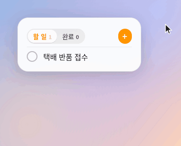
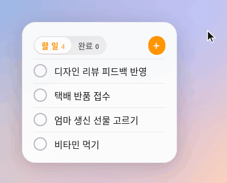
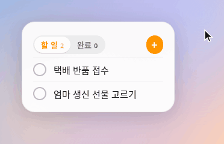
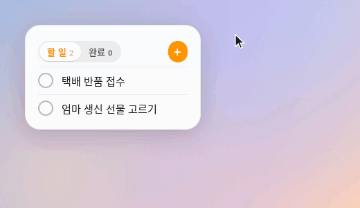

# reminder-widget

바탕화면에 띄워 두는 할 일 위젯입니다. 우분투(GNOME, X11)에서 동작합니다.


## 설치

```bash
git clone https://github.com/GyoungTaeChae/reminder-widget.git
cd reminder-widget
mkdir -p ~/.local/bin ~/.config/systemd/user
ln -s "$PWD/reminder-widget" ~/.local/bin/reminder-widget
cp reminder-widget.service ~/.config/systemd/user/
systemctl --user enable --now reminder-widget.service
```

한 번 설치하면 컴퓨터를 켤 때마다 자동으로 뜹니다.

## 사용법

### 추가하기
위젯을 한 번 누르고 Enter. 적고 Enter 를 누르면 다음 칸이 열리고, `Ctrl` + Enter 로 마칩니다.



### 날짜 붙이기
적는 중에 `@` 를 치면 달력이 나옵니다. 날짜, 시각, 알림 시점을 고르면 됩니다. 알림은 기본 10분 전입니다.


### 끝낸 일
동그라미를 누르면 `완료` 로 넘어갑니다. 여러 개를 연달아 눌러도 됩니다. `완료` 탭에서 다시 누르면 돌아오고, 휴지통을 두 번 누르면 완료 목록이 비워집니다.



### 고치기
글자를 누르면 바로 고칠 수 있습니다.



### 옮기기 · 폭 조절
목록 선 위쪽을 끌면 옮겨지고, `Ctrl` 을 누른 채 옆으로 끌면 폭이 바뀝니다. 높이는 할 일 개수에 맞춰 저절로 바뀝니다.



### 상단바
상단바의 체크 동그라미 아이콘을 누르면 `항상 위`, `사용법`, `종료` 가 있습니다. `사용법` 은 이 페이지를 엽니다. `항상 위` 를 켜면 다른 창 위에 떠 있고, 끄면 바탕화면에 붙어 있습니다.
종료한 뒤 다시 켜려면 `systemctl --user start reminder-widget` 를 실행하거나 다시 로그인하면 됩니다.

## 날짜 서식

달력 대신 `@` 뒤에 바로 써도 됩니다.

| 이렇게 쓰면 | 이렇게 됩니다 |
|---|---|
| `회의 @11-21 14:00` | 11월 21일 오후 2시 |
| `백업 @내일` | 내일 오전 9시 |
| `약 먹기 @15:30` | 오늘 오후 3시 30분 |
| `여권 갱신 @2027-01-05` | 2027년 1월 5일 오전 9시 |

`@오늘`, `@내일`, `@모레` 도 쓸 수 있습니다. 시각을 빼면 그날 오전 9시에 알려 줍니다.

## 라이선스

MIT
